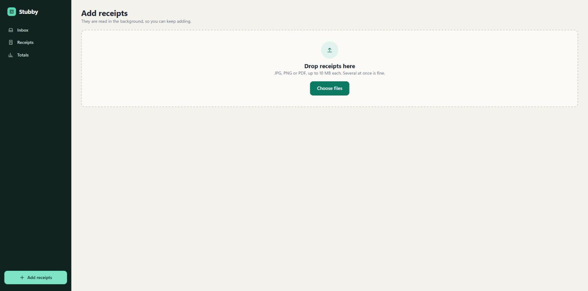
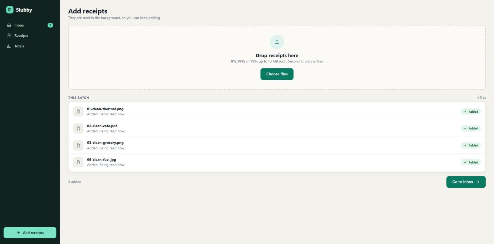
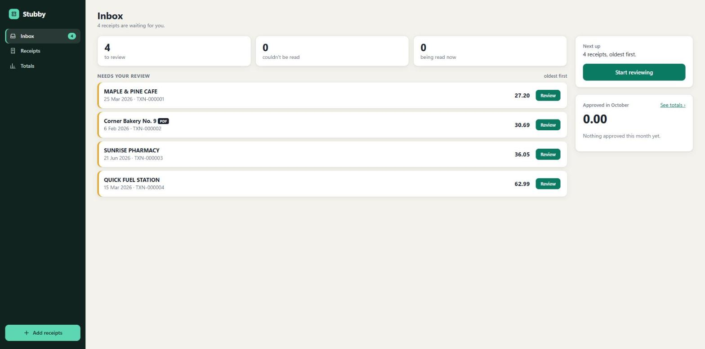
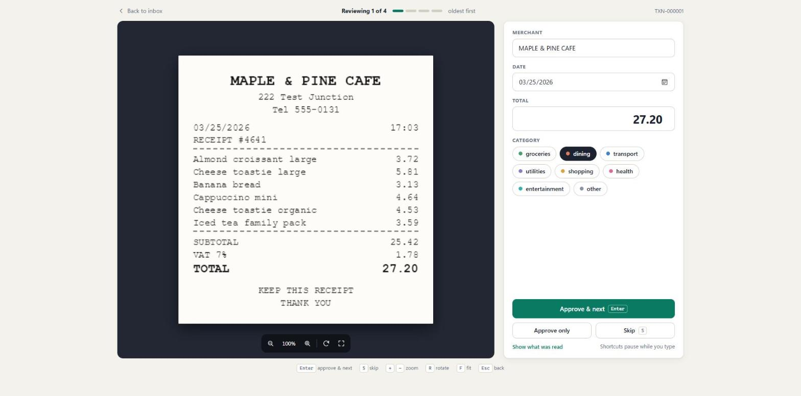
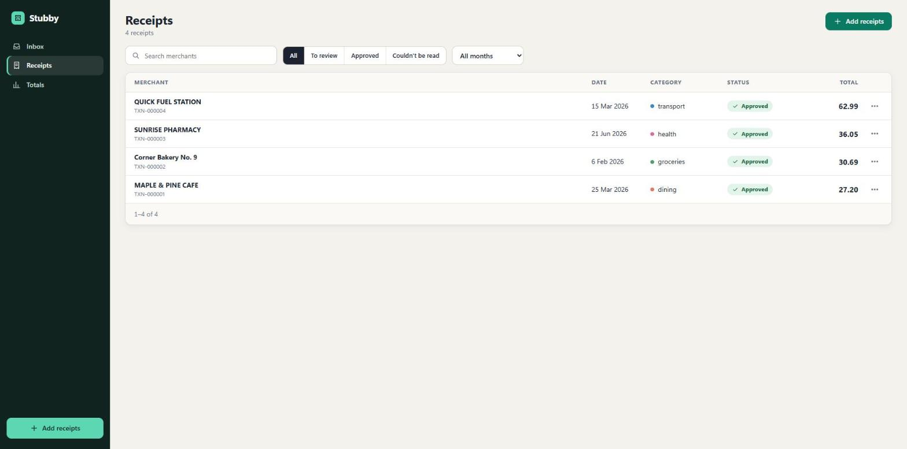
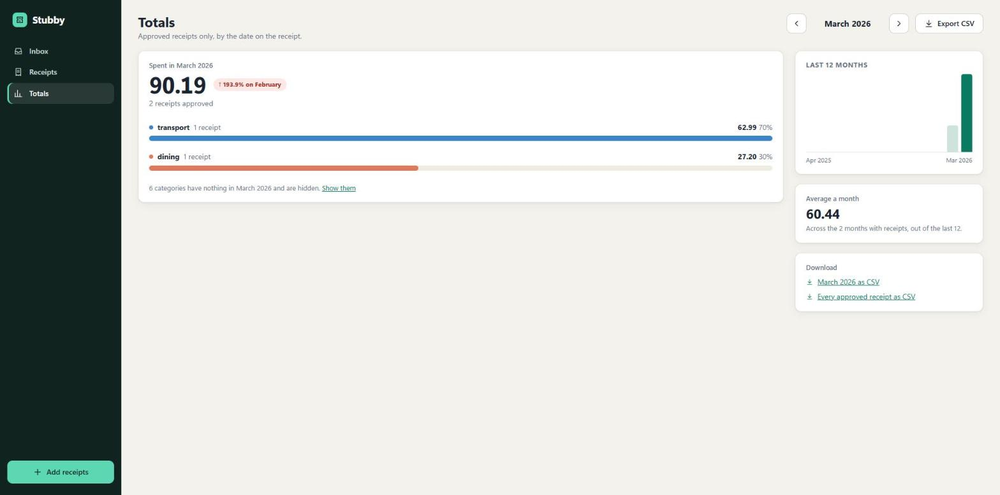

# Stubby

Take a photo of a receipt, check the details Stubby picked up, and see where this month's money went.

Stubby is a single-user web app. You upload a receipt (JPG, PNG or PDF). A vision model reads the merchant, date and total in the background. You review the result, correct anything that is wrong, pick a category and approve it. Approved receipts feed monthly totals by category, with CSV export.

## Status

Everything in the plan is built: upload, background extraction, review and approve, reprocess and delete, monthly totals and CSV export, and an eval tool that scores the model on 30 invented receipts in `testset/`.

It has run against the real model. On 2026-10-18 `gemma4:31b` with prompt v1 read all 30 receipts with every total, merchant and date right, so every accuracy target passes (see [`eval-report.md`](eval-report.md)). The test set is invented, with clean fonts and mild photo effects, so this shows the pipeline works end to end. It does not promise the same on real receipts.

## How it works

1. Upload a receipt. It is queued and processed in the background, so you can keep uploading.
2. A vision model extracts the merchant, date and total. Suspicious results are flagged.
3. Open the receipt, confirm or correct the details and choose a category.
4. Approved receipts count toward your monthly totals. Approved receipts can never be edited.

## Screenshots

The flow in the running app. The receipts are invented.

**1. Add receipts.** Drop JPG, PNG or PDF files, several at once.



**2. They are read in the background.** Each file shows as added, and you can keep uploading.



**3. The inbox lists what needs review.** Oldest first, with this month's approved total beside it (still 0.00 here, because nothing is approved yet).



**4. Review beside the receipt.** Check the merchant, date and total, pick a category, then approve and move to the next one.



**5. Approved receipts are listed and filterable.**



**6. Totals by category for each month.** With a 12-month strip and CSV export.



## Stack

- .NET 10 and Blazor Web App (Interactive Server)
- PostgreSQL with EF Core
- A hosted background worker reading a database-backed queue
- Vision model behind an interface. First provider: Ollama Cloud with `gemma4:31b`

## Run it

You need the .NET 10 SDK, a PostgreSQL server and an Ollama Cloud API key.

```
dotnet build Stubby.slnx
dotnet user-secrets set "AiGateway:OllamaCloud:ApiKey" "<your key>" --project src/Web
dotnet run --project src/Web
```

- The app reads the database from `ConnectionStrings:Stubby` in `src/Web/appsettings.json` (default: `postgres`/`postgres` on localhost). In Development it creates and migrates the database on start.
- Keep the API key in user-secrets or an environment variable.
- Uploaded receipts are sent to the model provider to be read.

Tests:

```
dotnet test --solution Stubby.slnx
```

The integration tests need a PostgreSQL server that can create databases. They use `postgres`/`postgres` on localhost, or the connection string in `STUBBY_TEST_PG`, and are skipped when no server is reachable.

Eval: `dotnet run --project src/Eval -- run` reads the test set through the real extractor, prints a scored report and writes `eval-report.md`. It sends the receipts to the model provider, so run it on purpose.

## Documentation

| Document | Contents |
|---|---|
| [Business requirements](docs/business-requirements.md) | Problem, goal, receipt statuses, scope, success criteria and the test set |
| [User stories](docs/user-stories.md) | User stories and the user flow |
| [Non-functional requirements](docs/non-functional-requirements.md) | Performance, accuracy, reliability, usability, data and security targets |
| [Architecture](docs/architecture.md) | Components, key decisions, main flows and rules |
| [Database design](docs/database-design.md) | Tables, columns, constraints, indexes and queue behavior |
| [Extraction prompt](docs/extraction-prompt.md) | The prompt and reply format the extractor uses, and each version of it |
| [Feature specs](docs/spec/) | One folder per module: receipts, extraction, reports and eval |
| [UI redesign](docs/redesign/README.md) | Audit of the earlier UI, wireframes and mockups |

## License

See [LICENSE](LICENSE).
