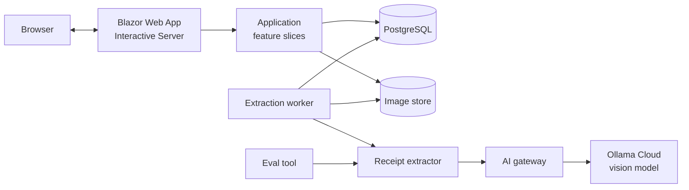
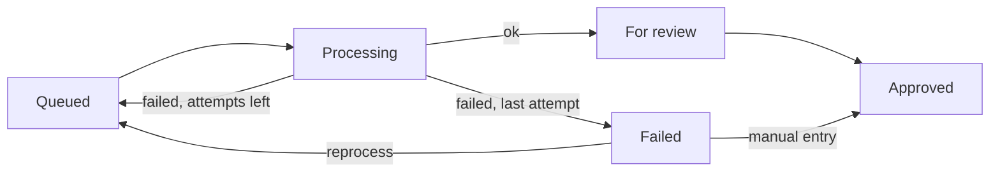

# Stubby : Architecture

Date: 2026-10-17  
Author: restocado  
Status: Accepted

## Overview

One deployable .NET 10 application: a Blazor web UI, a background worker and a PostgreSQL database. This fits a single-user app with no login.

## Key decisions

| Decision | Why |
|---|---|
| Blazor Web App, Interactive Server | One project, no separate API. Needs a live connection, which phones can drop, so state lives in the database, not the browser. |
| Upload through `InputFile`, not an HTTP endpoint | Single user and no other client, so the page calls the upload slice directly and gets a result value, not an HTTP status. Files travel over the Blazor circuit in segments. If phone uploads prove unreliable, an endpoint can be added without changing the slice. |
| PostgreSQL via EF Core, local install | Durable storage for receipts, field records and the queue. |
| The queue is the receipts table | Status is the queue state. No second source of truth. |
| Background worker in the same app | A hosted service reads from the database queue, as the BRD requires. Queued and Processing receipts survive a restart. |
| Image files on disk, path in the database | Keeps the database small. Deleting a receipt deletes its file. |
| First vision model: gemma4:31b on Ollama Cloud, set in app settings | It accepts images, unlike gpt-oss, which is text-only. The model name is configuration, so it can be changed without a code change. Each change should be checked by rerunning the 30-receipt eval set (NFR-M3). |
| PDFs rendered to images with PDFtoImage (MIT, targets .NET 10) | The vision model accepts only images. PDFtoImage renders each page to PNG. Its native PDFium engine is not thread-safe, so rendering needs a lock if more than one worker is ever used. |
| Money stored as exact decimals | No rounding drift in monthly totals. |
| Transaction number from a PostgreSQL identity column | The database hands out the next number safely under concurrent uploads and never reuses one (NFR-D6). No counter in application code. |
| Clean Architecture, one feature slice per command or query | Matches the user stories. |
| Slices are dispatched with Mediator (source-generated), registered as scoped | Pages send a command or query and get a response, with no reflection at run time. Scoped, so a handler may use scoped services. |
| Database context created per repository call, through `IDbContextFactory` | A Blazor circuit lives as long as the browser tab, so a scoped context would be shared by every page. It is not thread-safe, so the list refresh and an upload at the same time would collide, and it would keep stale tracked entities. A context per call avoids both. A slice that needs one transaction over several steps does it inside a single repository method. |
| Extraction behind a receipt extractor, which calls an AI gateway | Prompt and parsing are separate from provider access. Changing provider touches only an adapter (NFR-M2). |
| The gateway does not retry; the worker owns the attempt budget, a setting that starts at 1 | Two retry layers would multiply the attempts and break the configured total (NFR-R1). Starting at 1 means no automatic retry, which limits token use. |
| The gateway's timeout, rate limit and circuit breaker use `Microsoft.Extensions.Http.Resilience`, with no retry strategy | Standard, tested policies on top of Polly instead of hand-written ones. A call over the rate limit waits, up to its timeout. The timeout grows with the image count, because a long PDF takes longer than a photo. |

## Components

| Component | Responsibility |
|---|---|
| **Domain** | Receipt and field record rules, statuses, categories. Approved receipts are immutable (NFR-R4). |
| **Application** | One slice each for upload, list, review, approve, reprocess, delete, monthly totals, CSV export and processing the next receipt. |
| **Infrastructure** | Database access, image storage, PDF rendering, and the extractor implementation. |
| **AI gateway** | The only code that talks to model providers. Maps a model name to a provider, applies timeout, rate limit and circuit breaker, and logs usage without receipt content. There is no fallback provider in v1, and one can be added later. |
| **Web** | Blazor UI (upload through an `InputFile` component), the image and CSV export endpoints, and the hosted worker. |
| **Eval tool** | Console app that generates the 30 synthetic test receipts and their answer file (see the BRD test set), runs them through the extractor and reports accuracy (NFR-M3). |

Dependencies point inward: Web and Infrastructure → Application → Domain. The gateway knows nothing about receipts.

## Main flows

**Upload**: check size and file type, reject duplicates by checksum (the error carries the existing receipt's transaction number), store the file, add the receipt as Queued with its next transaction number, return immediately (NFR-P2).

**Processing**: the worker takes the oldest Queued receipt and sends all pages to the extractor. PDFs are rendered to images, every page. On success the receipt becomes For review, flagged if the checks fail. On failure it goes back to Queued while attempts remain, and when the configured maximum number of attempts (default 1) has failed it becomes Failed. With the default of 1, a failed extraction goes straight to Failed.

**Review and approve**: only For review and Failed receipts can be opened. Approving saves the final field values, a field record for each, and the category, then locks the receipt.

**Delete**: removes the receipt and its image. Field records stay, with no link back to the receipt.

**Reports**: monthly totals by category and the CSV export read Approved receipts only.

## Key rules

- **Flagging** (NFR-A4): a receipt is flagged if any of these is true. Subtotal and tax are read only for this check and are not stored.
  - The total is missing, zero or negative.
  - The total is at or above a limit set in the app settings (3000 to start with).
  - The receipt shows both a subtotal and a tax, and subtotal plus tax does not equal the total. Receipts without tax skip this check.
  - The date is missing, in the future, or more than a year old.
- **Field records** hold the before and after value, the model and the prompt version, with no link to the receipt (NFR-D1, D2). On approval a row is written for **every extracted field** (merchant, date and total), including unchanged ones where the two values are equal. This keeps the count of fields reviewed, so an accuracy rate can be computed even after receipts are deleted.
- **Transaction number**: assigned by the database when the receipt row is inserted, never by the application, and never stored on field records, which must stay unlinked (NFR-D2).
- **Manual entries** are tagged on the field record and excluded from accuracy numbers.
- **Accuracy**:
  - The **eval tool** scores the 30 test receipts against known answers. Total and date must match exactly. Merchant matches after ignoring case, spacing and punctuation. Flag coverage is wrong totals that were flagged, divided by all wrong totals.
  - **Real use** is scored from the stored field records: per field, unchanged rows divided by all rows, grouped by model and prompt version. There is no accuracy screen in v1. The records are kept so the report can be produced from them.
- **Outages**: if the provider is down, receipts use their attempts and become Failed. The user reprocesses them later (NFR-R3). The worker does not pause when the circuit is open. Token use from failed and repeated attempts is to be observed through the gateway usage logs, and pausing can be revisited if it proves wasteful.
- **Long PDFs** have no page limit, only the 10 MB size limit. A request that exceeds the gateway timeout counts as a failed attempt.

## Cross-cutting

- **Configuration**: model mapping, flag threshold, maximum attempts per receipt (default 1) and storage path come from app settings. Secrets come from user-secrets or environment variables (NFR-S3).
- **Logging**: no receipt content in logs.
- **Testing**: unit tests for rules and flagging, integration tests against a separate local test database, and fakes for the extractor and the provider.
