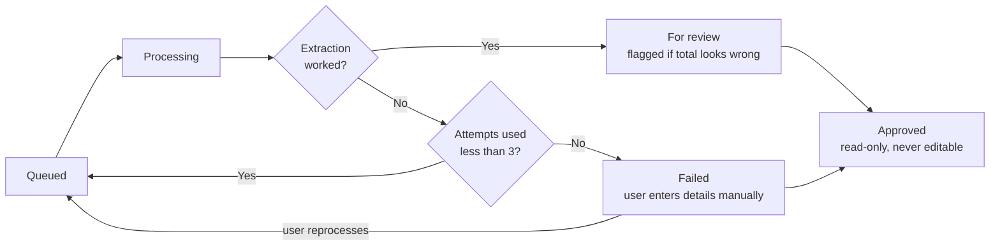

# Stubby : Business Requirements Document

Date: 2026-10-17  
Author: restocado

## Problem

People who track spending keep a pile of receipts and type each one into a spreadsheet by hand. It is tedious, so they fall behind, and by month-end they are guessing at totals and categories.

## Goal

Take a photo of a receipt, check the details Stubby picked up, and see where this month's money went.

## How it works

1. Upload a receipt image (JPG, PNG, or PDF). Any other file type is rejected with an error and never queued. A file whose checksum matches an existing receipt, approved or not, is a duplicate: the upload fails with an error and the file is never queued. The receipt is added to the processing queue automatically with the status Queued.
2. A background job picks up the receipt (status Processing) and sends the image to the vision model, which fills in the merchant, date, and total. While the receipt is Queued or Processing the user cannot open it. The user can keep uploading other receipts.
3. When extraction works, the receipt becomes For review, and it is flagged if the total looks wrong. If extraction does not work, the receipt is put back in the queue and retried automatically, up to 3 attempts in total per receipt. If the third attempt also fails, it becomes Failed.
4. A receipts list shows all receipts, newest first, with their status (Queued, Processing, Failed, For review, Approved). The user opens a For review or Failed receipt from this list.
5. A review screen shows the receipt beside the extracted fields. The user confirms or corrects them and picks the category from a fixed list: groceries, dining, transport, utilities, shopping, health, entertainment, other. For a Failed receipt the user enters the details manually.
6. Approved receipts feed monthly totals by category, with CSV export. Approved receipts can be viewed from the list but can never be edited.
7. The user can delete a receipt that is For review, Failed or Approved. Deleting removes the receipt and its image for good. The corrections made on it are kept without any link to the receipt, so the accuracy report stays complete. Deleting also takes it out of the monthly totals if it was Approved, and allows the same file to be uploaded again. Queued and Processing receipts cannot be deleted.
8. The user can reprocess a Failed receipt, or reprocess all Failed receipts at once. Each one goes back to Queued and gets a fresh set of 3 attempts. The user can also choose to enter the details manually instead.

## Receipt statuses

A receipt moves through these statuses. Queued and Processing receipts are locked, so the user cannot open or delete them. Only Approved receipts feed the monthly totals. Every correction made on the review screen is stored with the field name, the extracted value, the corrected value, the time, and the model and prompt version. Corrections are kept even if the receipt is deleted, but only as an anonymous record with no image or other receipt details.

## Users

People who want a monthly spending view without typing receipts into a spreadsheet.

## Out of scope

- Bank or card account syncing
- Mobile app (the web UI only needs to work in a phone browser)
- Multi-currency and tax-filing exports
- Shared or multi-user budgets
- Handwritten receipts
- Login or user accounts (the app is single-user for now)
- A retention policy for receipts and extracted data (nothing is deleted automatically for now)
- Custom categories (the category list is fixed for now)

## Success criteria

1. The total is extracted correctly on at least 90% of a set of 30 synthetic receipts.
2. Merchant and date are correct on at least 85% of the same set.
3. Of the receipts where extraction got the total wrong, at least 95% are flagged for review instead of being saved silently.
4. Median time from upload to a reviewed, saved receipt is under 60 seconds for a single-page receipt.
5. Every correction made in the review screen is stored, so a before/after accuracy report can be generated.

## Constraints and assumptions

- .NET 10 and Blazor
- Fake or synthetic receipts only for the demo
- Extraction uses a vision model behind an interface, so the provider can change
- The first provider is Ollama Cloud
- The queue must be stored durably so receipts survive an app restart
- The background job is a .NET hosted service that reads from a database-backed queue

## Open questions

- [ ] Which vision model to use on Ollama Cloud
- [ ] How the 30 sample receipts will be created (varied layouts, plus a few blurry photos)
