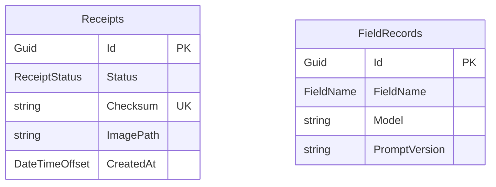

# Stubby : Database Design

Date: 2026-10-17  
Author: restocado  
Status: Accepted

Implements the data rules in [architecture.md](architecture.md), [business-requirements.md](business-requirements.md) and [non-functional-requirements.md](non-functional-requirements.md).

## Overview

PostgreSQL, accessed through EF Core with the Npgsql provider. Two tables:

- **Receipts**: one row per receipt. It is also the processing queue: `Status` is the queue state.
- **FieldRecords**: one row per reviewed field, kept for the accuracy report. It has no link to `Receipts`, so it survives deletion.

Image files live on disk. `Receipts.ImagePath` points at the file. Settings (model, flag limit, maximum attempts, storage path) are app settings, not tables.



There is no foreign key between the two tables on purpose (NFR-D2).

## Naming conventions

The database follows the EF Core and .NET defaults, so the model needs almost no mapping configuration.

| Item | Convention | Example |
|---|---|---|
| Table | PascalCase, plural, the `DbSet` name | `Receipts`, `FieldRecords` |
| Column | PascalCase, same as the C# property | `ImagePath`, `CreatedAt` |
| Primary key | Property `Id`; constraint `PK_<Table>` | `PK_Receipts` |
| Index | `IX_<Table>_<Columns>`; unique index uses the same pattern | `IX_Receipts_Checksum` |
| Check constraint | `CK_<Table>_<Rule>` | `CK_Receipts_FileSize` |
| Booleans | Prefixed `Is` | `IsFlagged`, `IsManualEntry` |
| Timestamps | Suffixed `At`, type `DateTimeOffset`, stored as `timestamptz` | `CreatedAt` |
| Enums | C# enum, stored as its name in a text column with `HasConversion<string>()` | `ReceiptStatus.ForReview` |
| Money | C# `decimal`, `numeric(15,2)` | `Total` |
| Dates | C# `DateOnly`, stored as `date` | `ReceiptDate` |

Because the names are PascalCase, PostgreSQL requires them to be quoted in raw SQL (`"Receipts"."Total"`). EF Core does this automatically. There is no snake_case mapping.

### Enums

| Enum | Values |
|---|---|
| `ReceiptStatus` | `Queued`, `Processing`, `Failed`, `ForReview`, `Approved` |
| `ReceiptCategory` | `Groceries`, `Dining`, `Transport`, `Utilities`, `Shopping`, `Health`, `Entertainment`, `Other` |
| `FieldName` | `Merchant`, `Date`, `Total` |
| `ReceiptContentType` | stored as the MIME string: `image/jpeg`, `image/png`, `application/pdf` |

The category list is fixed, so it is an enum with a check constraint, not a lookup table. The UI shows the names in lowercase, as in the BRD.

## Table: Receipts

| Column | C# type | PostgreSQL type | Null | Notes |
|---|---|---|---|---|
| Id | `Guid` | uuid | no | Primary key. |
| TransactionNo | `long` | bigint | no | Generated by the database as an identity column (`GENERATED ALWAYS AS IDENTITY`), starting at 1. Unique. Never set or changed by the app, never reused (NFR-D6). |
| Status | `ReceiptStatus` | text | no | Check constraint. |
| OriginalFileName | `string` | text | no | As uploaded. Shown in the list. |
| ContentType | `string` | text | no | MIME type. Check constraint. |
| FileSizeBytes | `int` | integer | no | 10 MB maximum (NFR-S1). Check constraint. |
| Checksum | `string` | text | no | SHA-256 of the file, hex. Unique (see Duplicates). |
| ImagePath | `string` | text | no | Path relative to the configured storage path. |
| AttemptsUsed | `int` | integer | no | Failed extraction attempts so far. Default 0. Reset to 0 on reprocess. |
| LastError | `string?` | text | yes | Short reason for the last failed attempt. No receipt content. |
| ExtractedMerchant | `string?` | text | yes | Raw model output. Null if not read. |
| ExtractedDate | `DateOnly?` | date | yes | Raw model output. Null if not read. |
| ExtractedTotal | `decimal?` | numeric(15,2) | yes | Raw model output. Null if not read. |
| Model | `string?` | text | yes | Model that produced the extraction. |
| PromptVersion | `string?` | text | yes | Prompt version used. |
| IsFlagged | `bool` | boolean | no | Set when extraction finishes (NFR-A4). Default false. |
| FlagReasons | `string?` | text | yes | Comma-separated reason codes, shown on the review screen. |
| Merchant | `string?` | text | yes | Final value. Set on approval. |
| ReceiptDate | `DateOnly?` | date | yes | Final value. Set on approval. |
| Total | `decimal?` | numeric(15,2) | yes | Final value. Set on approval. |
| Category | `ReceiptCategory?` | text | yes | Final value. Set on approval. Check constraint. |
| IsManualEntry | `bool` | boolean | no | True when the user typed the details on a Failed receipt. Default false. |
| CreatedAt | `DateTimeOffset` | timestamptz | no | Upload time. |
| UpdatedAt | `DateTimeOffset` | timestamptz | no | Last change. |
| ApprovedAt | `DateTimeOffset?` | timestamptz | yes | Set on approval. |

Notes:

- **Transaction number is stored as a number and displayed as text.** The `TXN-000042` form is built when the value is shown or exported, never stored. See the BRD for the format.
- **Transaction number comes from the database.** EF Core maps it with `UseIdentityAlwaysColumn()` and `ValueGeneratedOnAdd`, so the app cannot write it. Identity values are not rolled back, and deleted receipts leave gaps, so the series can have gaps but never repeats. It is not copied to `FieldRecords`, which must stay unlinked (NFR-D2).
- **Subtotal and tax are not columns.** They are read only for the flag check and are discarded (BRD).
- **Extracted and final values are separate properties.** The review screen edits in memory only and nothing is saved until approval, so the extracted values stay untouched until then. This keeps state in the database and not the browser.
- **Approved rows are immutable** (NFR-R4). The Domain enforces this. A trigger is not added in v1.
- **No concurrency token in v1.** Queue claims use row locks (see Queue behavior). If the UI later allows two tabs to act on the same receipt, add a `xmin` row version.

### Check constraints

| Name | Rule |
|---|---|
| CK_Receipts_Status | `Status` is one of the five values. |
| CK_Receipts_ContentType | `ContentType` is one of the three MIME types. |
| CK_Receipts_FileSize | `FileSizeBytes` is between 1 and 10 485 760. |
| CK_Receipts_Category | `Category` is null or one of the eight categories. |
| CK_Receipts_Approved | When `Status = 'Approved'`: `Merchant`, `ReceiptDate`, `Total`, `Category` and `ApprovedAt` are all not null. |
| CK_Receipts_Manual | `IsManualEntry` is true only when `ExtractedMerchant`, `ExtractedDate` and `ExtractedTotal` are all null. |

### Indexes

| Name | Columns | Purpose |
|---|---|---|
| IX_Receipts_TransactionNo | `TransactionNo`, unique | Lookup by transaction number. |
| IX_Receipts_Checksum | `Checksum`, unique | Duplicate rejection, approved or not. |
| IX_Receipts_CreatedAt_Id | `CreatedAt` desc, `Id` desc | Paged list, newest first, 25 per page (NFR-P3). |
| IX_Receipts_CreatedAt_Queued | `CreatedAt`, filtered where `Status = 'Queued'` | Worker takes the oldest Queued receipt. |
| IX_Receipts_ReceiptDate_Category | `ReceiptDate`, `Category`, filtered where `Status = 'Approved'` | Monthly totals and CSV export. |
| IX_Receipts_Id_Failed | `Id`, filtered where `Status = 'Failed'` | Reprocess all Failed. |

Filtered indexes use `HasFilter` in the EF Core model.

## Table: FieldRecords

| Column | C# type | PostgreSQL type | Null | Notes |
|---|---|---|---|---|
| Id | `Guid` | uuid | no | Primary key. |
| FieldName | `FieldName` | text | no | `Merchant`, `Date` or `Total`. Check constraint. |
| ExtractedValue | `string?` | text | yes | What the model returned. Null if it returned nothing, and for manual entries. |
| FinalValue | `string` | text | no | What was approved. Dates as `yyyy-MM-dd`, totals with two decimals, invariant culture. |
| IsManual | `bool` | boolean | no | Manual entries are excluded from accuracy numbers (NFR-D5). |
| Model | `string?` | text | yes | Null for manual entries. |
| PromptVersion | `string?` | text | yes | Null for manual entries. |
| CreatedAt | `DateTimeOffset` | timestamptz | no | Approval time. |

Notes:

- **Three rows per approved receipt**, one for each of merchant, date and total, including unchanged ones. This keeps the count of fields reviewed (architecture, Key rules).
- **No receipt id, image path or file name.** Nothing here links back to a receipt (NFR-D2).
- **Values are text** because the three fields have different types. Comparing `ExtractedValue` to `FinalValue` works the same for all of them.
- Rows are only inserted, never updated. Deleting a receipt does not touch them.

### Check constraints

| Name | Rule |
|---|---|
| CK_FieldRecords_FieldName | `FieldName` is one of `Merchant`, `Date`, `Total`. |

### Indexes

| Name | Columns | Purpose |
|---|---|---|
| IX_FieldRecords_Model_PromptVersion_FieldName | `Model`, `PromptVersion`, `FieldName`, filtered where `IsManual = false` | Per field accuracy by model and prompt version. |

### Accuracy query

```sql
SELECT "Model", "PromptVersion", "FieldName",
       count(*) FILTER (WHERE "ExtractedValue" IS NOT DISTINCT FROM "FinalValue")::numeric
         / count(*) AS "Accuracy"
FROM "FieldRecords"
WHERE "IsManual" = false
GROUP BY "Model", "PromptVersion", "FieldName";
```

The merchant check in the eval tool ignores case, spacing and punctuation. This query is an exact match and is a stricter measure.

## Queue behavior

The `Receipts` table is the queue. There is no second table.

| Event | Change |
|---|---|
| Upload | Insert with `Status = Queued`, `AttemptsUsed = 0`. |
| Worker picks up | In one transaction, select the oldest Queued row with `FOR UPDATE SKIP LOCKED` and set `Processing`. |
| Extraction works | Store `Extracted*`, `Model`, `PromptVersion`, `IsFlagged`, `FlagReasons`. Set `ForReview`. |
| Extraction fails, attempts left | `AttemptsUsed + 1`, set `LastError`, back to `Queued`. |
| Extraction fails, last attempt | `AttemptsUsed + 1`, set `LastError`, set `Failed`. |
| App restart | Every `Processing` row goes back to `Queued`. `AttemptsUsed` is not changed, since no attempt finished (NFR-R2). |
| Reprocess | `Failed` to `Queued`, `AttemptsUsed = 0`, `LastError = null`. Also for all Failed at once. |

EF Core has no `SKIP LOCKED` support in LINQ, so the claim query is raw SQL (`FromSql`). `SKIP LOCKED` makes a second worker safe in the future. The PDF rendering lock noted in the architecture is separate and still needed.

## Duplicates

The unique index on `Checksum` is the final guard. The upload slice checks first to return a clear error, and handles a unique violation if two identical uploads race. Deleting a receipt removes its row, so the same file can be uploaded again.

## Approval

In one transaction (`SaveChanges` writes all of it together):

1. Check the receipt is `ForReview` or `Failed`.
2. Write `Merchant`, `ReceiptDate`, `Total`, `Category`, `IsManualEntry`, `ApprovedAt`, and set `Approved`.
3. Insert the three `FieldRecords` rows.

If any step fails, none of it is saved.

## Deletion

In one transaction, delete the receipt row. After commit, delete the image file. If the file delete fails, the leftover file is harmless, is logged, and has no database row pointing at it. Only `ForReview`, `Failed` and `Approved` receipts can be deleted. `FieldRecords` are not touched.

## Reports

- **Monthly totals**: sum of `Total` grouped by month of `ReceiptDate` and by `Category`, where `Status = Approved`.
- **CSV export**: approved receipts only (NFR-D3). Columns: transaction no (as `TXN-000042`), date, merchant, category, total.

## Migrations

EF Core migrations, applied by the app on startup in development. Integration tests run against a separate local test database (architecture, Testing).

## Not in v1

- No users table, since there is no login.
- No currency column, since multi-currency is out of scope.
- No soft delete, since deletion is permanent.
- No audit table for edits to receipts, since approved receipts cannot be edited.
