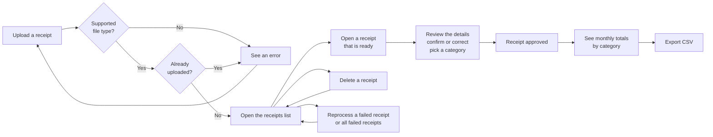

# Stubby : User Stories and Flow

Date: 2026-10-17  
Author: restocado

## User stories

1. As a user, I want to upload a receipt image (JPG, PNG or PDF), so that I don't have to type it into a spreadsheet.
2. As a user, I want to see an error when I upload an unsupported file, so that I know it was not accepted.
3. As a user, I want to keep uploading receipts while earlier ones are still being read, so that I can add a pile of receipts in one go.
4. As a user, I want to see a list of all my receipts, newest first, with their status, so that I know which ones are ready for me.
5. As a user, I want to open a receipt that is ready and see the image beside the extracted merchant, date and total, so that I can check what Stubby picked up.
6. As a user, I want to correct any detail and pick a category, so that the receipt is accurate before it is saved.
7. As a user, I want to enter the details myself when Stubby could not read a receipt, so that I don't lose it.
8. As a user, I want to send a failed receipt back to be processed again, so that I can try again without uploading the file a second time.
9. As a user, I want to reprocess all my failed receipts at once, so that I can recover quickly after the provider was down.
10. As a user, I want the upload to fail when I upload a file I already uploaded, whether or not it is approved, and see the transaction number of the existing receipt, so that I don't count the same receipt twice.
11. As a user, I want to approve a receipt, so that it counts toward my monthly totals.
12. As a user, I want to see my monthly totals by category, so that I know where my money went.
13. As a user, I want to delete a receipt, so that I can remove mistakes and upload the file again.
14. As a user, I want to export my data as a CSV, so that I can use it elsewhere.
15. As a user, I want each receipt to get a transaction number from the system, so that I can refer to a receipt by a short, unique number.

## User flow

